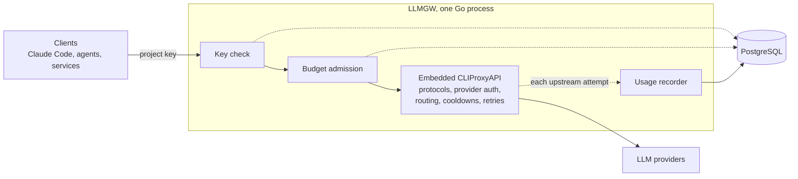

# LLMGW

LLMGW is a self-hosted LLM gateway written in Go. A single binary embeds
[CLIProxyAPI](https://github.com/router-for-me/CLIProxyAPI) as a library, so the
whole gateway is one process, one container and one listener, with no second
service, child process or reverse proxy between LLMGW and the SDK.

On top of CLIProxyAPI's provider plumbing, LLMGW authenticates every client with a
project key, applies per-project budgets and records normalized request and usage
attempts in PostgreSQL.
CLIProxyAPI still owns provider protocols, provider authentication, model routing,
cooldowns and retries.

It exists so that consumers send a standard request and never handle provider
credentials, and a backend can change without any change on their side.
It also tracks usage per project and enforces budgets inside the gateway, instead
of leaving that to each consumer. Claude Code, OpenCode and Hermes Agent work with
it through their normal API-key setting.

## Features

- Every generation and metadata request needs a project key, sent as
  `Authorization: Bearer` or `x-api-key`, whatever network layer sits in front.
  Keys are created, rotated with an overlap window and revoked from the command
  line, and each deployed client should get its own.
- Budgets on calls, tokens or notional cost, over an hourly or daily window, either
  block a project or only warn.
- Every upstream attempt is recorded in PostgreSQL, and a project's usage can be
  read back by key, model or provider.
- Priority tiers decide which provider accounts take traffic, and session affinity
  keeps a conversation on the account that holds its prompt cache.
- Each project can carry a default Anthropic thinking effort and a guard that
  refuses non-streamed responses with leaked tool-call markup.
- Requests in the Anthropic Messages format are rewritten so the provider's prompt
  cache stays stable from one call to the next.
- An optional Discord webhook reports state changes on provider credentials,
  generations, project keys, budgets, and gateway and database health.
- A PostgreSQL session lock refuses a second server on the same database, and
  migrations run at startup.
- Every merge to `main` ships a versioned image on GHCR and a GitHub Release.

## How it fits together



The code is hexagonal, as rules rather than a file tree. The domain holds the
governance rules and the ports they need, with no HTTP, SQL or SDK import. The
adapters cover PostgreSQL, the boundary with the embedded SDK and the Discord
webhook. The composition
root does the wiring and the local operator commands, and holds no business logic.
PostgreSQL is mandatory, and there is no fallback store.

The SDK is consumed unmodified, from pristine upstream sources at the version
pinned in `go.mod`. It's never forked, patched or vendored, so upgrading it is a
normal module upgrade with nothing to reapply.

The embedded SDK refreshes its model catalog from upstream at runtime, so a newly
released model becomes routable without an LLMGW release. A failed refresh keeps
the last valid catalog, and the catalog embedded in the pinned SDK version is the
fallback at startup. To pin the catalog, set `models.catalog` to an `http(s)` URL
or an absolute file path, and the SDK reads only that source.

## Deploy

LLMGW reads one shared YAML file. Native CLIProxyAPI fields sit at the root, in
CLIProxyAPI's flat layout, and LLMGW's own settings sit under `llmgw`. The grouped
v8 layout (`server`, `management`, `observability`, …) is refused at startup,
because LLMGW validates the security-sensitive settings by their flat spelling.
Keep provider credentials in the YAML only when the native SDK requires them, and
otherwise render the file from your secret manager. The PostgreSQL credentials and
the project-key pepper stay in environment variables or the secret manager.

```sh
cp config.example.yaml config.yaml
cp .env.example .env
chmod 600 config.yaml
```

`config.yaml` is bind-mounted read-only and can contain native API-key provider
entries, so its host-side mode must stay `0600`. The example binds the container
listener to `0.0.0.0:8088`, and Compose publishes that listener only on
`127.0.0.1:8088`. It mounts the persistent `cliproxy-auth` named volume at
`/var/lib/llmgw/cliproxy-auth`. PostgreSQL is deliberately external, so create an
`llmgw` database and give the configured role access before you start.

Run exactly one active `llmgw serve` for a PostgreSQL database and its persistent
CLIProxyAPI auth directory. A dedicated PostgreSQL session lock rejects a second
server that shares the database before startup recovery can change live rows.
Don't scale replicas, share one auth directory across independent databases, or
roll out with overlap. Stop the old server completely before starting its
replacement.

Generate and store a stable pepper of at least 32 bytes, using a cryptographically
secure random source. For example:

```sh
openssl rand -base64 48
```

Put that value in `LLMGW_KEY_PEPPER` and set `LLMGW_POSTGRES_DSN` in `.env`. The
`.env.example` file lists the deployment inputs: `LLMGW_CONFIG`,
`LLMGW_POSTGRES_DSN`, `LLMGW_KEY_PEPPER`, `LLMGW_IMAGE_TAG`, and the optional
`LLMGW_DISCORD_WEBHOOK_URL` (see [Alerts](#alerts)).

The `llmgw` block of the YAML holds the rest. `postgres-dsn-env`,
`key-pepper-env` and `discord-webhook-url-env` name the environment variables that
carry those secrets, not the secrets themselves, and default to the names above.
`usage-retention-days` keeps usage history for that many whole days (default 35,
minimum 2, which is what the daily budget window needs).
`usage-outstanding-capacity` bounds the admitted generations still waiting for
their usage record (default 64, maximum 1024).

Start the service. Migrations run during startup:

```sh
docker compose up -d
docker compose logs -f llmgw
curl -fsS http://127.0.0.1:8088/healthz
```

To roll out a release, set `LLMGW_IMAGE_TAG` to the immutable version tag you
picked and run `docker compose pull`. Images are tagged with the bare version
number, without the `v` of the git tag. Route traffic away, stop the running service
with `docker compose down`, check that no other `llmgw serve` uses the database or
the auth directory, then run `docker compose up -d`. The same configuration works
for a host binary with `LLMGW_CONFIG=./config.yaml llmgw serve`, and a host-binary
upgrade follows the same stopped-traffic cutover.

The runtime image is distroless and runs as user and group `65532:65532`. Keep the
CLIProxyAPI auth directory writable by that user and persistent through its named
volume, because the SDK rotates provider credentials there.

## Provider authentication

Provider credentials belong to CLIProxyAPI's persistent auth directory, not to the
LLMGW database. Manage them with the local admin commands against the shared
configuration:

```sh
llmgw auth login claude
llmgw auth list
llmgw auth import-legacy
llmgw auth priority claude-main@example.com.json 10
```

### Priority accounts

A credential can carry a priority tier. The highest available tier takes all the
traffic, and a lower tier is used only while every account above it is
unavailable (cooldown, quota, disabled). Accounts in the same tier share the load
round-robin, per conversation while `session-affinity` is on. Without a priority,
every account sits in the same tier.

With `session-affinity` on, as shipped, a conversation stays on the account it's
bound to for as long as that account remains available. New conversations go to
the highest available tier at once, but a conversation that started on a
lower-tier account during an outage, or moved to one, stays there after the higher
tier recovers.

`llmgw auth priority ID N` sets the tier. `ID` is the `id` shown by `auth list`
and `N` is an integer. A higher number wins, `0` clears the priority, and a
negative number makes a last-resort account. The server reads priorities when it starts,
and a running server would overwrite the file when it refreshes a token, so the
command refuses to run while a server is up. Stop the server, set the priority,
then start it again.

## Projects and keys

A project is created by issuing its first key. There is no separate create
command.

```sh
llmgw key create analytics --name claude-code
llmgw key list analytics
llmgw key rotate KEY_ID --overlap 15m
llmgw key revoke KEY_ID
```

`key create` prints the plaintext project key once, so store it in the deployed
client's secret store. Create one key per deployed client, and a project can own
many keys. A key is mandatory for every generation and metadata request, whatever
network layer sits in front of the gateway, and exposing the gateway directly
requires TLS termination in front of it.

Clients can use either standard header, but not both with conflicting values:

```sh
curl http://127.0.0.1:8088/v1/chat/completions \
  -H 'Authorization: Bearer LLMGW_PROJECT_KEY'

curl http://127.0.0.1:8088/v1/chat/completions \
  -H 'x-api-key: LLMGW_PROJECT_KEY'
```

The embedded SDK serves its supported provider protocol routes, including
Anthropic Messages, OpenAI Chat Completions and Responses, and Gemini where
configured. Claude Code, OpenCode and Hermes Agent point at the LLMGW base URL and
take the project key issued for that deployed client in their normal API-key
setting.

Beyond its keys, a project carries two settings that the gateway applies to the
generation requests (`POST /v1/messages`) it authenticates:

```sh
llmgw project list
llmgw project effort analytics xhigh
llmgw project markup-guard analytics on
```

`project list` prints each project's name, creation time, default effort and
markup-guard state.

`project effort NAME low|medium|high|xhigh|max|none` sets a default Anthropic
thinking effort, injected as `output_config.effort` into every generation request
that doesn't name its own. A request that already carries an effort is left
alone, whatever its value, and so is one whose client disabled thinking, because
Anthropic refuses a level above `high` next to disabled thinking. `none` removes
the default.

`project markup-guard NAME on|off` makes the gateway refuse a non-streamed
generation response whose tool-call inputs carry leaked function-call markup. The
client gets a retryable upstream error instead of a corrupted success it would
consume. Streamed responses pass through untouched, because their tool inputs
arrive as partial JSON deltas that no complete-document scan can screen.

## Budgets and usage

Set a project's limits, then read back what it consumed:

```sh
llmgw budget set analytics --dimension calls --window day --max 1000 --action block
llmgw budget list analytics
llmgw budget delete LIMIT_ID

llmgw usage show analytics --since 24h --by model
llmgw usage resolve REQUEST_ID --assume-zero
```

Budgets cover `calls`, `tokens` or notional `cost` across an hourly or daily
window. With `--action block` a budget stops traffic, and with `--action warn`
requests still go through and the breach only raises a warning. Calls are counted
exactly. Token and cost budgets admit requests on what
has already been recorded, then stop the following calls once a completed request
crosses the limit. They can't revoke an upstream request that's already in flight.
Notional subscription cost is an accounting estimate, not a provider invoice.

An abrupt crash can leave an undetectable tail of multi-attempt usage after a
request was admitted. Such requests are marked for accounting resolution. Use
`usage resolve REQUEST_ID --assume-zero` only after an operator has reviewed them,
and only when zero is the conservative resolution you want.

The example's native defaults retry once (`request-retry: 1`) and try at most two
provider credentials (`max-retry-credentials: 2`). CLIProxyAPI puts provider and
auth failures in cooldown according to its native settings. Tune `request-retry`,
`max-retry-credentials`, `max-retry-interval`, `transient-error-cooldown-seconds`
and the credential pool in `config.yaml` to match the provider and the latency you
want. Keep the required security settings from the example. LLMGW checks them at
startup and refuses to start if CLIProxyAPI's own `api-keys` list isn't empty, if
remote management, the control panel, home or pprof is turned on, or if
`MANAGEMENT_PASSWORD` is set.

## What the gateway rewrites on Anthropic requests

Two routes are rewritten on their way upstream, `POST /v1/messages` and
`POST /v1/messages/count_tokens`, both in the Anthropic Messages format. Every
other protocol route the embedded SDK serves passes through untouched.

### Tool names

Every client-defined tool (a declaration with no `type`, or with
`type: "custom"`) is sent upstream as `mcp__llmgw__<name>`, consistently in
`tools[]`, in `tool_choice` and in the `tool_use` blocks replayed from the
conversation history. The original name is restored in responses, streaming
included, so clients never see the prefix. Tools that Anthropic itself defines
(recognized by their `type`, never by their name), names that already start with
`mcp__`, and names longer than 52 characters are left as they are.

The reason is the prompt cache. On OAuth credentials, the embedded SDK rewrites
client tool names with a per-request value, which changes the very start of the
prompt on every call and defeats the provider's cache. A name already in the MCP
shape is forwarded verbatim, so the cached prefix stays stable. `count_tokens`
gets the same rewrite, so the count matches the payload actually sent. Source:
`internal/domain/toolprefix`.

### Context editing

A generation payload that carries no `context_management` gets
`{"edits": []}`. Left absent, the field is filled in by the SDK with a
thinking-clearing strategy of its own, which rewrites the conversation prefix on
every turn and makes the cache unusable. A client that sends its own
`context_management` keeps it. Source: `internal/domain/contextedit/claim.go`.

### Thinking display

When a generation payload asks for adaptive or enabled thinking and carries no
`thinking.display`, the gateway sets it to `omitted`, so callers keep receiving
thinking blocks with their content redacted, as they always have. Left absent, the
field is filled in by the SDK on cloaked requests for the models that support it,
which switches the response to streamed thinking updates and drops that
redaction. A payload that already sets a display, whatever its value, is left
alone. Source: `internal/domain/thinkingdisplay/claim.go`.

### Default effort

The project's default thinking effort is injected as described in
[Projects and keys](#projects-and-keys). Source: `internal/domain/effort`.

Session affinity handles the same concern one layer down. `config.example.yaml`
enables `routing.session-affinity` so a conversation sticks to one upstream
credential. The provider's prompt cache lives per account, and a multi-turn agent
loop that round-robins across a pool pays for its whole context again. Keep it
enabled.

## Alerts

With `LLMGW_DISCORD_WEBHOOK_URL` set, the gateway posts to Discord when one of
these changes state:

- a provider credential stops authenticating, hits its rate limit, starts failing
  or recovers
- generations start failing or recover
- a project key is about to expire or has expired
- a budget starts warning, starts blocking or clears
- the gateway starts or stops, or the database goes away and comes back

`key create`, `key rotate`, `auth login` and `auth import-legacy` post a message
too. Each alert carries a severity (critical, warning or info). A state that was
already reported isn't sent again, and an alert of the same kind for the same
entity waits at least 15 minutes before it repeats, unless the situation gets
worse. The channel is outbound only and adds no listener.

One critical alert also stops the service. When usage can no longer be correlated
with the requests that produced it, the gateway reports it and shuts down, so the
supervisor can restart a healthy process instead of keeping one that answers 503
to every generation.

Leaving the variable empty or absent disables Discord alerting entirely, and
enabling it needs outbound access from the container to the webhook's host,
normally `discord.com` over HTTPS. When a webhook is configured and Discord is
unreachable, those four commands take up to five seconds longer to exit. The
command still succeeds, and the delivery failure is only a warning on stderr.

## CI, live verification and releases

Automatic CI runs formatting, vet, build, race-checked domain and adapter tests,
and the hermetic integration suite for the embedded CLIProxyAPI. It has no live
provider credentials and doesn't run `test/e2e`. Live verification is run by the
operator, gated on `LLMGW_LIVE_CONFIG`, and is never recreated as a GitHub Actions
workflow holding provider tokens.

Every merge to `main` ships a version, which the pull request sets in the
`VERSION` file at the repo root. A fix bumps the patch number, a new capability
that leaves existing callers unaffected bumps the minor number, and a change
consumers have to adapt to bumps the major number. On merge, `tag-on-merge.yml` refuses a
malformed or already-tagged version, creates the `v<version>` tag, then calls
`release.yml`, which builds the image, pushes it to `ghcr.io/clemsix6/llmgw` as
both `<version>` and `latest`, and creates the GitHub Release.

## License notice

LLMGW embeds CLIProxyAPI as a library, from pristine upstream sources at the
version pinned in `go.mod`. Its MIT license is included in
[`third_party/CLIProxyAPI/LICENSE`](third_party/CLIProxyAPI/LICENSE), and
[`THIRD_PARTY_NOTICES.md`](THIRD_PARTY_NOTICES.md) has the pinned-source notice.

Keep `disable-image-generation` set to `true` and leave the payload write rules
empty. Together they guarantee that each upstream attempt reports exactly one
usage record, which the gateway's accounting relies on, and both are enforced at
startup.
